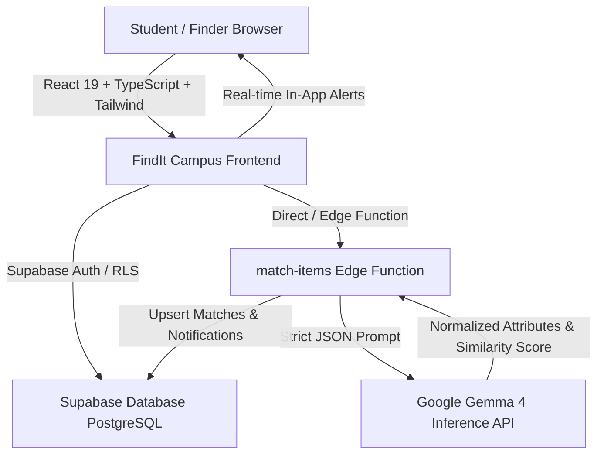

# FindIt Campus — AI-Powered Campus Lost & Found Assistant

> **Tagline:** *Lost something? Let AI help you find it.*  
> Built for Hackathon Excellence with **Google Gemma 4**, **React**, **TypeScript**, **Tailwind CSS**, and **Supabase**.

---

## 1. Executive Summary & Problem Statement

College students frequently misplace critical belongings—student IDs, keys, wallets, laptops, earbuds, and textbooks. 

The traditional campus recovery mechanisms are broken:
- **Chaotic WhatsApp / Telegram Groups:** Reports quickly get buried in noise; searchability is practically non-existent.
- **Physical Notice Boards & Security Desks:** Low student visibility; requires students to physically walk between multiple buildings asking staff.
- **Fraud & False Claims:** Unchecked public photos allow opportunistic individuals to falsely claim valuable electronics and accessories.

### The Solution: FindIt Campus
**FindIt Campus** is an AI-assisted, privacy-first lost & found web platform designed specifically for college campuses. By integrating **Google Gemma 4 (`gemma-4-26b-a4b-it`)**, the platform bridges the descriptive gap between how different students describe the same physical object, while safeguarding student privacy through secret-attribute verification and authenticated security handovers.

---

## 2. Key Hackathon Innovations

1. **Autonomous Semantic Attribute Extraction (Feature A):**  
   Google Gemma 4 ingests unstructured reports and normalizes them into structured JSON schemas (extracting brand, color, distinguishing traits, and campus zone landmarks) without hallucinating unmentioned traits.
2. **Two-Stage Matching Pipeline (Feature B):**  
   - **Stage 1 (Candidate Retrieval):** Database spatio-temporal filtering by category, campus zone, and timestamp proximity.  
   - **Stage 2 (Gemma 4 Semantic Comparison):** High-probability candidate pairs are evaluated by Gemma 4 for semantic description similarity, conflicts, and missing information.
3. **Mathematically Bounded Hybrid Scoring:**  
   AI confidence is never blindly trusted. Final relevance is computed using:
   $$\text{Final Score} = (\text{Deterministic Score} \times 0.45) + (\text{Gemma 4 Semantic Score} \times 0.55)$$
   *(Deterministic: 35% Category, 25% Location Zone, 20% Date Proximity, 20% Keyword Tokens)*
4. **Privacy-Conscious Reporting & Anti-Fraud Verification:**  
   Finders can withhold secret identifying traits (e.g. initials on an ID card, specific keychain charm, lockscreen photo). Claimants must provide matching secret proof before campus security authorizes an in-person physical handover.
5. **Audited Status Lifecycle & Confetti Celebrations:**  
   Every state transition (`REPORTED` $\to$ `POTENTIAL MATCH` $\to$ `CLAIM REQUESTED` $\to$ `UNDER REVIEW` $\to$ `RETURNED`) is logged in an append-only security audit trail.

---

## 3. System Architecture



---

## 4. Database Design & Security

### Tables & Schema
- `profiles`: Synced with `auth.users`, storing `display_name`, `role` (`student` | `admin`), and avatar.
- `item_reports`: Stores lost and found listings, campus zone, timestamps, image paths, secret withheld attributes, and Gemma 4 parsed JSON metadata.
- `item_matches`: Stores pairs of lost and found reports, relevance scores (0-100), explainable match reasons, observed conflicts, missing info, and model identifier.
- `claims`: Encrypted private verification details submitted by claimants, review notes, and status (`pending`, `under_review`, `approved`, `rejected`).
- `notifications`: In-app event alerts for AI matches and claim status changes.
- `audit_logs`: Immutable, append-only security logs recording every report creation, status modification, and admin action.

### Row Level Security (RLS) Policies
- **Role Elevation Prevention:** Students cannot modify their own `role` column.
- **Private Claim Protection:** Secret claim proof is strictly visible only to the claimant, the finder, and authorized campus security administrators.
- **Audit Immutability:** Audit records can never be updated or deleted by ordinary users.

---

## 5. Quick Hackathon Demo Instructions (Turnkey Evaluation)

The application includes a **1-Click Persona Switcher Banner** at the top of the interface:

| Persona | Role | Email | Capabilities |
| :--- | :--- | :--- | :--- |
| **Alex Rivera** | Student | `alex.rivera@campus.edu` | Report lost items, view personal dashboard, inspect AI matches, file claims |
| **Samantha Chen** | Student | `samantha.chen@campus.edu` | Report found items with privacy withholding, inspect claims on found items |
| **Officer Dave Miller** | Admin | `dave.miller@security.campus.edu` | Access **Admin Portal**, review secret verification answers, approve/reject claims, suspend listings, view audit trail |

### How to Run Locally

```bash
# 1. Install dependencies
npm install

# 2. Run local development server
npm run dev

# 3. Access in browser
# http://127.0.0.1:5173/
```

### Build & Typecheck Validation
```bash
npm run build
```

---

## 6. Deployment Guide

### A. Supabase Setup
1. Create a project at [supabase.com](https://supabase.com).
2. Go to the **SQL Editor** and run the migration file:
   `supabase/migrations/20261024000001_findit_campus_schema.sql`
3. In **Storage**, ensure the `item-photos` bucket is created (automatically configured by the migration).
4. Deploy the Supabase Edge Function:
   ```bash
   supabase functions deploy match-items --no-verify-jwt
   supabase secrets set GEMMA_API_KEY=your_key GEMMA_MODEL=gemma-4-26b-a4b-it
   ```

### B. Vercel Deployment
1. Connect your GitHub repository to [Vercel](https://vercel.com).
2. In Project Settings $\to$ **Environment Variables**, set:
   - `VITE_SUPABASE_URL` = `https://your-project.supabase.co`
   - `VITE_SUPABASE_ANON_KEY` = `your-anon-key`
   - `VITE_GEMMA_MODEL` = `gemma-4-26b-a4b-it`
3. Deploy! The included `vercel.json` ensures client-side SPA routing works seamlessly.

---

## 7. 3-Minute Hackathon Pitch & Presentation Script

### [0:00 - 0:40] The Problem
> *"Judges, every day across university campuses, hundreds of student IDs, wallets, keys, and laptops are lost. Where do students turn? Cluttered WhatsApp groups where messages vanish, or physical security boards. It takes days to find an item, and anyone can claim a lost item by guessing what it looks like. We built **FindIt Campus** to solve this once and for all."*

### [0:40 - 1:30] The Gemma 4 AI Innovation
> *"Students describe things differently: a student reports a 'black Fossil bifold wallet lost in the library study zone', while a finder reports 'found black leather wallet on 2nd floor desk'. Exact search queries fail.*  
> *FindIt Campus uses **Google Gemma 4** in a two-stage pipeline. First, Stage 1 filters plausible spatial and temporal candidates. Second, Gemma 4 evaluates semantic traits, colors, wear patterns, and generates an explainable match card with an 88% relevance score, explicit reasons, and potential conflicts."*

### [1:30 - 2:20] Privacy & Anti-Fraud Verification
> *"Crucially, AI doesn't hand over the item. When Samantha found the wallet, our privacy-conscious mode hid the owner initials. When Alex submits a claim, he enters secret proof only the owner knows: 'fossil brand with a dinosaur sticker on the metro pass'.*  
> *Let's switch to Officer Dave Miller in Campus Security. In the Admin Portal, Dave compares the finder's ground truth with the claimant's answer. When he clicks 'Approve', celebratory confetti fires, the audit log records the handover, and the status changes to RETURNED."*

### [2:20 - 3:00] Impact & Conclusion
> *"FindIt Campus is fast, transparent, secure, and production-ready. It protects student privacy, prevents fraud, and harnesses Google Gemma 4 to bring peace of mind to campus life. Thank you!"*

---

## 8. Limitations & Future Work
- **Multimodal Image Verification:** Optional image embeddings for cross-checking visual wear patterns as multimodal Gemma endpoints expand.
- **Campus Card RFID Integration:** Automated NFC reading at campus security desks to cross-reference university student directories with encrypted hashes.
- **Automated Locker Pickups:** Integration with smart IoT campus lockers for contactless 24/7 recovery.
